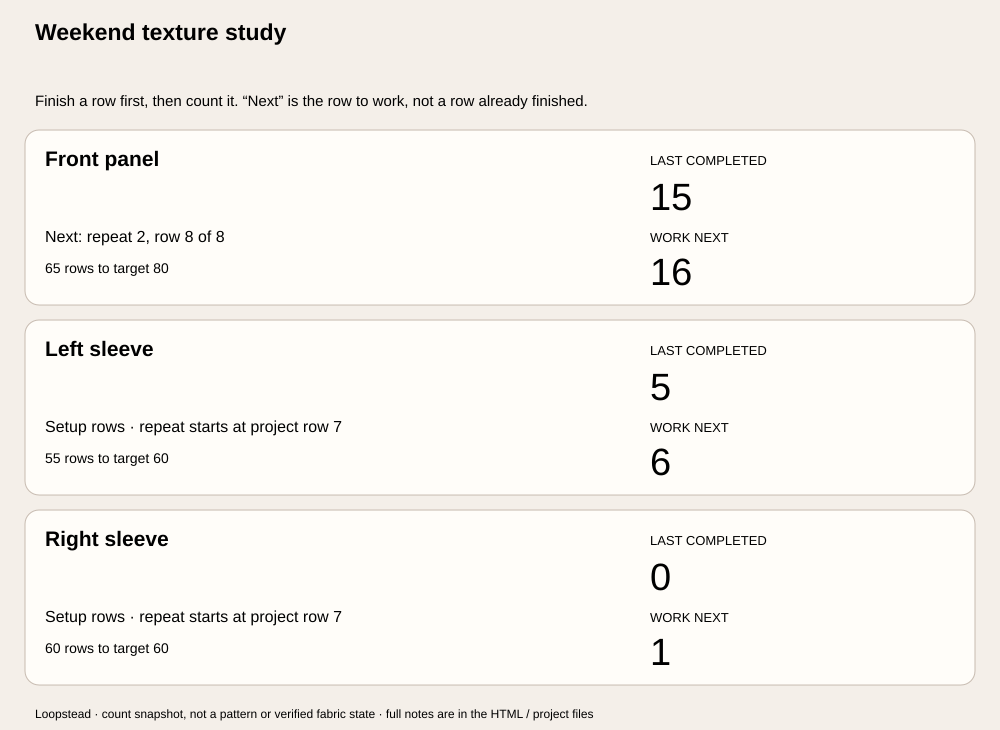

# Loopstead

**Know what you finished. See what to work next.**

A local row counter for small knitting and crochet projects. Keep independent parts together, track repeating row blocks, and leave yourself a clear place to return.



*Generated SVG from the included example, not a screenshot of the editor.*

## Features

- **Two explicit numbers:** last row completed and project row to work next.
- Up to **eight independent parts**, each with its own count, notes and optional target.
- Repeat length and starting-row offset for setup rows before a repeating section.
- Large “Finished row…” buttons, one-row corrections, editable counts and 25-action undo / redo.
- Local browser saving, visible storage-failure status and review of changed browser copies.
- Portable project JSON, derived count receipts, printable HTML notes and SVG snapshots.

No account, analytics, application uploads, paid APIs or runtime dependencies.

## Run locally

Use Node.js 22 or 24 and npm:

```sh
npm ci --ignore-scripts --no-audit --no-fund
npm test
npm run example
npm run build
npm run dev
```

Open **http://127.0.0.1:4198**. The development server binds only to loopback and serves allowlisted built files. Rebuild after changing source files.

jsdom is used only for development tests. The static build uses Node built-ins.

## Count with one convention

1. Name the project, add your own notes and save the details.
2. Add a part: front panel, sleeve, back, or another independent piece. Enter **rows already completed**, not the row you are currently knitting.
3. Work the large **next row** number. Only after finishing it, tap **Finished row…**.
4. If you miscount, use **Back one row**, **Undo**, or **Edit / correct** to enter the known completed count.
5. Save project JSON periodically. It is your portable backup.

If you have finished 7 rows, Loopstead shows **last completed 7 / work next 8**. The software cannot tell whether a tap represents actual finished work. Check the fabric and your own pattern if you lose your place.

### Repeats without resetting the total

For an 8-row repeat starting at project row 1:

| Rows completed | Project row next | Position to work next | Full repeats recorded |
| --- | --- | --- | --- |
| 0 | 1 | Repeat 1, row 1 | 0 |
| 7 | 8 | Repeat 1, row 8 | 0 |
| 8 | 9 | Repeat 2, row 1 | 1 |
| 15 | 16 | Repeat 2, row 8 | 1 |

For six setup rows, set **first repeat starts on row 7**. Before row 7, the card says setup rows. With repeat length 6, the first full repeat is recorded after finishing project row 12.

A target is the planned total number of rows. Reaching it does not stop the counter; further counted rows remain visible. Repeat tracking is arithmetic, not pattern interpretation.

## Saving and recovery

One project is saved under this website’s origin in this browser on this device. There is no project library, account, cross-device sync or server backup.

- Saved actions write immediately when local storage is available.
- **Form drafts are not saved.** Save or clear them before counting, changing projects or downloading.
- Private browsing, denied storage, quota errors or browser-data clearing can prevent or remove local saving. A visible warning identifies memory-only operation.
- A changed browser copy triggers review. Export this tab first, then select **Load browser copy** or **Keep this tab**. Keeping the tab explicitly replaces the stored copy.
- These checks are **best effort, not an atomic cross-tab lock**. Near-simultaneous writes can race. Use one editing tab.
- Invalid or unsupported stored data is preserved until you explicitly replace it or open a valid backup.
- Opening a project JSON replaces this tab and its browser copy. The previous project can be restored with Undo during this session. Undo history itself is not persisted.

A failed write leaves the current session usable in memory, with a warning. Use **Keep this tab / retry saving** after restoring storage access, or download JSON.

## Export formats

| File | Purpose |
| --- | --- |
| Project JSON | Exact editable fields and stable part IDs; reopen this to continue |
| Count receipt JSON | Entire project plus derived completed/next rows, repeats and target status |
| Resume HTML | All part counts, repeat settings, targets, part notes and project notes; open and Print / Save as PDF |
| Snapshot SVG | Visual count/repeat summary for all parts; notes remain in HTML / JSON |

Actual example files: [project](examples/texture-project.json), [receipt](examples/texture-receipt.json), [resume sheet](examples/texture-resume.html), [SVG](examples/texture-resume.svg). The example is invented and contains no knitting pattern.

## Limits and privacy

Eight parts; 0–999,999 completed rows per part; repeat length 1–1,000 or blank; repeat start and target 1–999,999. At the count limit, advancing is disabled; the derived next row remains 1,000,000. Blank repeat length disables repeat tracking.

Title 80, project notes 1,000, part name 48 and part notes 400 UTF-16 units. Imports accept this version’s exact schema only, up to 30,000 characters / 120,000 UTF-8 bytes. Invalid data rejects the whole import without partially applying it.

Entered project data is not uploaded. The host still receives ordinary asset requests. Files and browser storage can contain your personal notes; keep backups somewhere appropriate.

There is no chart/PDF import, pattern recognition, stitch guidance, timing prediction, notification system, wake lock or offline installation. An already loaded page uses local operations, but reloading it without internet is not guaranteed. This tool records counts; it cannot verify fabric, correct a pattern or prevent missed taps.

## Verification

`npm test` exercises model bounds, repeat boundaries with independent step-by-step recounts over 51 start/length configurations, immutable edits, bounded history, local save/reload, stale-copy handling, invalid storage preservation, denied/quota storage, complete escaped exports, UTF-8 checks, backup-read races, actual UI event handlers, focus restoration and current download Blob contents.

CI runs Node 22 and 24 on Windows and Linux. UI tests use **jsdom, a simulated DOM**. Native browser interactions, visual responsiveness, assistive technology, actual cross-tab browser behavior, native download destinations, physical printing and a real editor screenshot have not been verified. The image above is a generated export.

## Deploy on Vercel

Import this repository, choose framework **Other**, Node **24.x**, build command `npm run build`, output directory `dist`, and an empty install command. No environment variables or paid services are needed. `vercel.json` supplies static build settings and security headers.

## Code

- `src/model.mjs`: strict schema and row/repeat arithmetic
- `src/edit.mjs`: reversible actions and 25-action history
- `src/storage.mjs`: local persistence and browser-copy review
- `src/export.mjs`: escaped complete exports and count snapshot
- `src/app.mjs`: forms, counters and focus handling
- `src/handoff.mjs`: bounded file loading and object URL lifecycle

[File-format notes](docs/file-format.md). MIT licensed.
